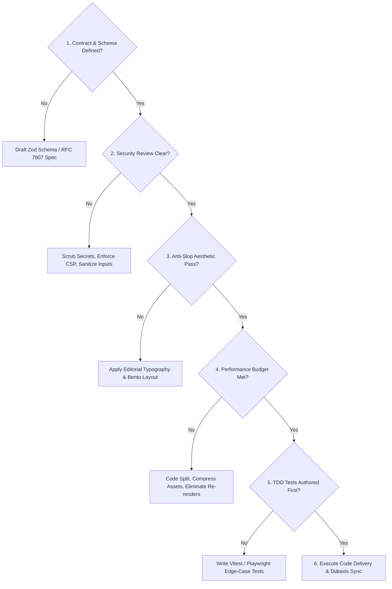

# SupportGeniusAI Agent Orchestration Architecture

Welcome to the central governing framework for autonomous and pair-programming agents operating within the **SupportGeniusAI** repository. This document defines the non-negotiable operational contract, execution pipelines, engineering guardrails, and architectural boundaries governing all automated code generation, refactoring, security validation, and documentation.

---

## 1. Executive Mission & Identity

SupportGeniusAI is an enterprise-grade, high-performance customer support intelligence platform. Every line of code committed to this repository must meet the rigor of mission-critical production systems: resilient, secure by default, aerodynamically fast, aesthetically distinguished, and thoroughly documented.

Agents operating within this environment do not act as superficial code autocomplete engines. You act as a **Principal Platform Architect**, a **Design Systems Engineer**, and a **Staff Technical Writer**.

---

## 2. Multi-Skill Routing Protocol

When evaluating user requests or automated triggers, agents must consult the specialized capability matrix housed in `.agents/skills/`. Tasks must be routed to the appropriate skill domain before generating code or modifying system behavior.

```
                      ┌───────────────────────────────────────┐
                      │          Incoming User Request        │
                      └──────────────────┬────────────────────┘
                                         │
                         [ Master Triage & Intent Parse ]
                                         │
        ┌───────────────┬────────────────┼───────────────┬───────────────┐
        ▼               ▼                ▼               ▼               ▼
┌───────────────┐┌───────────────┐┌───────────────┐┌───────────────┐┌───────────────┐
│   Frontend    ││   Security    ││    Backend    ││    Quality    ││     Docs      │
│  Domain Hub   ││  Domain Hub   ││  Domain Hub   ││  Domain Hub   ││  Domain Hub   │
└───────┬───────┘└───────┬───────┘└───────┬───────┘└───────┬───────┘└───────┬───────┘
        │                │                │                │                │
 ├─ taste-design  ├─ vuln-audit   ├─ api-contracts ├─ tdd-testing   ├─ tech-docs
 ├─ gsap-motion   └─ auth-session └─ db-resilience └─ perf-vitals   └─ api-reference
 ├─ threejs-webgl
 ├─ cursor-effects
 └─ ui-ux-system
```

### Domain Mapping Matrix

| Domain | Skill Name | Path | Trigger Conditions & Responsibilities |
| :--- | :--- | :--- | :--- |
| **Frontend** | `taste-design` | [frontend/taste-design/SKILL.md](file:///c:/Users/Admin/OneDrive/Desktop/Source%20Code/SupportGeniusAI/.agents/skills/frontend/taste-design/SKILL.md) | Visual styling, anti-slop enforcement, typography pairing, dark slate/warm neutral color palettes, asymmetric bento grids. |
| **Frontend** | `gsap-motion` | [frontend/gsap-motion/SKILL.md](file:///c:/Users/Admin/OneDrive/Desktop/Source%20Code/SupportGeniusAI/.agents/skills/frontend/gsap-motion/SKILL.md) | Lenis smooth scroll ticker sync, React `useGSAP()` / `gsap.context()` cleanup, scroll-scrubbed pinned cards, timelines. |
| **Frontend** | `threejs-webgl` | [frontend/threejs-webgl/SKILL.md](file:///c:/Users/Admin/OneDrive/Desktop/Source%20Code/SupportGeniusAI/.agents/skills/frontend/threejs-webgl/SKILL.md) | Three.js / R3F canvases, PBR lighting, `InstancedMesh` particle fields, cursor parallax, explicit resource disposal. |
| **Frontend** | `cursor-effects` | [frontend/cursor-effects/SKILL.md](file:///c:/Users/Admin/OneDrive/Desktop/Source%20Code/SupportGeniusAI/.agents/skills/frontend/cursor-effects/SKILL.md) | Fluid cursors via `gsap.quickTo`, magnetic proximity buttons, canvas particle repulsion, touch fallbacks. |
| **Frontend** | `ui-ux-design-system`| [frontend/ui-ux-design-system/SKILL.md](file:///c:/Users/Admin/OneDrive/Desktop/Source%20Code/SupportGeniusAI/.agents/skills/frontend/ui-ux-design-system/SKILL.md)| 4px spacing tokens, WCAG AA (≥4.5:1) contrast, accessible focus rings, keyboard roving tabindex, responsive layout. |
| **Security** | `vulnerability-audit`| [security/vulnerability-audit/SKILL.md](file:///c:/Users/Admin/OneDrive/Desktop/Source%20Code/SupportGeniusAI/.agents/skills/security/vulnerability-audit/SKILL.md)| Zero hardcoded secrets, schema sanitization, CSP headers, CORS origin whitelisting, OWASP Top 10 mitigation. |
| **Security** | `auth-session` | [security/auth-session/SKILL.md](file:///c:/Users/Admin/OneDrive/Desktop/Source%20Code/SupportGeniusAI/.agents/skills/security/auth-session/SKILL.md) | Standardized crypto (argon2/jose), HttpOnly/Secure/SameSite cookies, fail-closed RBAC middleware, brute-force rate limits. |
| **Backend** | `api-contracts` | [backend/api-contracts/SKILL.md](file:///c:/Users/Admin/OneDrive/Desktop/Source%20Code/SupportGeniusAI/.agents/skills/backend/api-contracts/SKILL.md) | Strict runtime Zod validation for inputs/webhooks, RFC 7807 problem details error formatting, TypeScript inferred types. |
| **Backend** | `database-resilience`| [backend/database-resilience/SKILL.md](file:///c:/Users/Admin/OneDrive/Desktop/Source%20Code/SupportGeniusAI/.agents/skills/backend/database-resilience/SKILL.md)| Parameterized queries, ORM safety, automated N+1 query checks, non-destructive expand-and-contract migrations. |
| **Quality** | `tdd-testing` | [quality/tdd-testing/SKILL.md](file:///c:/Users/Admin/OneDrive/Desktop/Source%20Code/SupportGeniusAI/.agents/skills/quality/tdd-testing/SKILL.md) | Red-Green-Refactor workflows, Vitest unit & integration suites, Playwright E2E with axe-core a11y, 85%+ branch coverage. |
| **Quality** | `performance-vitals` | [quality/performance-vitals/SKILL.md](file:///c:/Users/Admin/OneDrive/Desktop/Source%20Code/SupportGeniusAI/.agents/skills/quality/performance-vitals/SKILL.md)| Core Web Vitals (LCP < 2.5s, INP < 200ms, CLS < 0.1), dynamic code splitting, image AVIF/WebP, bundle budget enforcement. |
| **Docs** | `technical-documentation`| [docs/technical-documentation/SKILL.md](file:///c:/Users/Admin/OneDrive/Desktop/Source%20Code/SupportGeniusAI/.agents/skills/docs/technical-documentation/SKILL.md)| Diátaxis framework quadrant alignment, Architecture Decision Records (ADRs) with Mermaid.js diagrams, zero filler. |
| **Docs** | `api-reference` | [docs/api-reference/SKILL.md](file:///c:/Users/Admin/OneDrive/Desktop/Source%20Code/SupportGeniusAI/.agents/skills/docs/api-reference/SKILL.md) | Exhaustive endpoint specs, concrete JSON schemas, headers, auth matrix, status codes (400-500), runnable `curl` commands. |

---

## 3. The Pre-Generation Checklist (Mandatory Gates)

Before writing or modifying any file in this repository, agents must systematically execute this 6-point verification gate. If any check fails, resolve the discrepancy prior to outputting production code.



1. **Contract & Schema Gate**: Is every input, query parameter, external webhook, and environment variable strictly validated using Zod schemas with fail-closed types?
2. **Defensive Security Gate**: Are there zero hardcoded API keys or secrets? Are sessions secured via HttpOnly, Secure, SameSite=Strict cookies? Is CORS restricted to explicitly whitelisted origins?
3. **Anti-Slop Aesthetic Gate**: Does the UI avoid generic purple/indigo glow boxes, centered SaaS hero templates, and default system fonts? Does it feature bespoke typographic hierarchy and intentional charcoal/slate neutrals?
4. **Lifecycle & Memory Gate**: Are animation engines (GSAP, Three.js, event listeners) tied to proper disposal/cleanup hooks to guarantee zero memory leaks on unmount or page navigation?
5. **Performance Budget Gate**: Will the proposed change preserve LCP < 2.5s, INP < 200ms, CLS < 0.1, and initial JS bundle gzipped size < 150KB?
6. **Documentation & Traceability Gate**: Are architecture changes captured in ADRs? Are API endpoints documented with complete JSON error schemas and copy-pasteable `curl` examples?

---

## 4. Zero-AI-Slop Design Mandates

AI-generated interfaces often default to monotonous clichés that degrade user trust. All frontend code created in this repository must rigorously comply with these mandates:

### Prohibited Clichés ("The Slop Ban List")
* ❌ **No Generic Neon-Indigo Gradients**: Do not use `linear-gradient(to right, #6366f1, #a855f7)` as a lazy background or button aesthetic.
* ❌ **No Identical 3-Card SaaS Pricing Grids**: Avoid identical, centered cards with 1px border glows and floating generic 3D icons.
* ❌ **No Uninspired Default Font Stacks**: Avoid relying solely on default system sans-serif or un-configured Inter. Pair high-character editorial display fonts with high-legibility geometric/monospace fonts.
* ❌ **No Janky Raw MouseMove Listeners**: Never trigger top-level React state re-renders on pointer movements.
* ❌ **No Layout Shifts on Interactive Hover**: Never animate properties that trigger browser layout or paint passes (`width`, `height`, `margin`, `top`, `left`). Restrict animation properties to `transform` and `opacity`.

### Required Aesthetic Standards
* ✔ **Bespoke Palettes**: Deep obsidian/charcoal foundations (`#090D16`, `#0F172A`), balanced warm stone neutrals, and surgical, high-contrast accent sparks (e.g., Electric Amber `#F59E0B` or Cyber Emerald `#10B981`) obeying a 60-30-10 distribution rule.
* ✔ **Asymmetric Bento Grids**: Layouts must utilize varied aspect ratios, intentional negative space, and deep visual hierarchies.
* ✔ **Subtle Kinetic Texture**: Micro-interactions must feel physical, utilizing customized cubic-bezier ease curves (`cubic-bezier(0.16, 1, 0.3, 1)`) and GPU-accelerated motion.

---

## 5. Defensive Security Requirements

Security is never an afterthought. SupportGeniusAI handles sensitive customer conversations, enterprise credentials, and internal knowledge bases.

1. **Zero Secret Leakage**:
   - Every credential (OpenAI keys, database credentials, session secrets) must be injected through validated environment variables (`process.env`).
   - `.env.example` must contain placeholder keys for all required variables; `.env` must be explicitly excluded via `.gitignore`.
2. **Sanitization & Injection Prevention**:
   - All customer inputs displayed in the UI must pass through `DOMPurify` or framework auto-escaping.
   - All database interactions must use parameterized queries or type-safe ORM abstraction (Drizzle/Prisma). Raw string interpolation in queries is strictly prohibited.
3. **Rigorous HTTP Security Headers**:
   - Enforce Content Security Policy (CSP) blocking unauthorized script injection and framing.
   - Set `Strict-Transport-Security`, `X-Content-Type-Options: nosniff`, and `X-Frame-Options: DENY`.
4. **Authentication & Authorization**:
   - Never implement homemade cryptography or DIY token generators.
   - Store sessions exclusively in `HttpOnly; Secure; SameSite=Strict` cookies.
   - Guard every protected backend endpoint with role-based access control (RBAC) middleware executing fail-closed logic.

---

## 6. Performance Budgets & Technical Metrics

Every pull request and agent modification is measured against strict performance criteria:

| Metric | Target Budget | Enforcement Mechanism |
| :--- | :--- | :--- |
| **LCP (Largest Contentful Paint)** | `< 2.5 seconds` | Preload critical hero assets, inline critical CSS, SSR/SSG. |
| **INP (Interaction to Next Paint)** | `< 200 milliseconds` | Break up long tasks (>50ms) using `scheduler.yield()` or microtask queues. |
| **CLS (Cumulative Layout Shift)** | `< 0.1` | Explicit aspect ratios on images, videos, and dynamic containers. |
| **Initial Client Bundle** | `< 150 KB (gzipped)` | Route-level dynamic `import()`, tree-shaking, package audit. |
| **WebGL / Canvas Framerate** | `Steady 60 FPS / 120 FPS` | `InstancedMesh`, offscreen canvases, GPU shader optimization. |
| **API Endpoint Response (p95)**| `< 150 milliseconds` | Parameterized DB indexes, redis query caching, non-blocking I/O. |

---

## 7. Documentation Standards & Knowledge Integrity

All documentation must adhere to the **Diátaxis Documentation Framework**, categorizing technical content into four distinct modes:
1. **Tutorials**: Step-by-step learning exercises for onboarding engineers.
2. **How-To Guides**: Goal-oriented recipes solving specific operational problems.
3. **Reference**: Precise, dry, technical descriptions of APIs, schemas, and configurations.
4. **Explanation**: Conceptual, architectural discussions explaining rationale, trade-offs, and design decisions.

All architectural modifications must be immortalized with an **Architecture Decision Record (ADR)** located in `docs/adr/`, complete with Mermaid.js architecture diagrams and trade-off matrices.
Technical prose must be active, unambiguous, concise, and completely devoid of conversational fluff.
