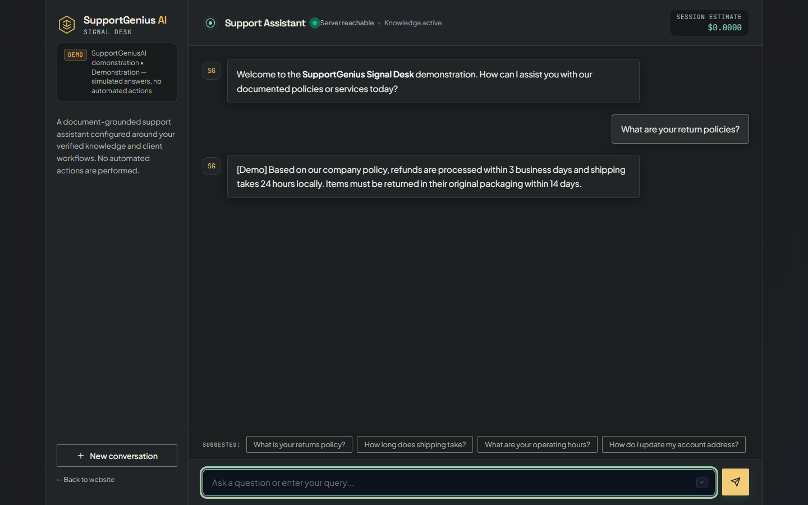
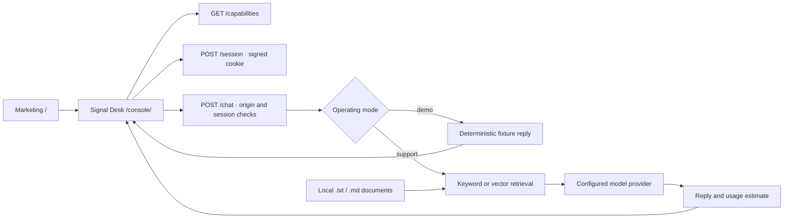
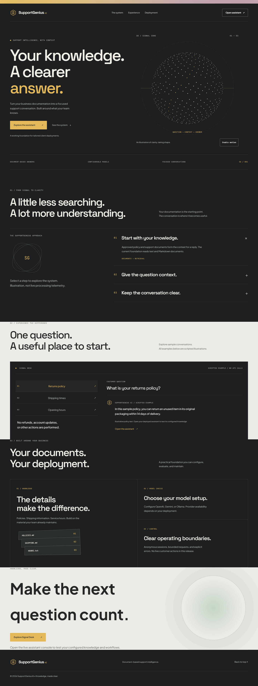

<p align="left"></p>

# SupportGenius AI

**Knowledge, made clear.** A document-based customer support assistant built with Express and vanilla JavaScript for tailored client deployments.

SupportGenius AI retrieves context from configured business documents and generates replies through a selected model provider. Signal Desk keeps the conversation, usage estimates, and recovery controls in one focused interface.

[Quick start](#quick-start) · [Architecture](#architecture) · [Verification](#verification) · [Deployment](docs/deployment.md) · [Design system](design.md)



*Integrated Signal Desk workspace, captured from the live application at commit `0f90bb1` in local demo mode (`APP_MODE=demo`, viewport 1440×1000). Demonstrates clean answered state, session cost estimate, and recovery controls. Contains sample content; does not establish real-provider answer quality.*

## Current capabilities

| Available | Boundary |
| --- | --- |
| Text/Markdown document retrieval | Local `.txt` and `.md` documents; no PDF/DOCX upload pipeline |
| Configurable OpenAI, Gemini, or Ollama | Availability depends on provider credentials, model, and deployment |
| Deterministic demo mode | Fixture replies, with zero provider calls |
| Anonymous signed-cookie sessions | Not customer authentication; in-memory state expires and resets on restart |
| Bounded requests and recoverable errors | No guarantee of answer accuracy or provider availability |
| Usage/cost estimates | Estimates may be unavailable; not binding billing records |

Customer actions, live integrations, source-citation delivery, durable transcripts, and multi-tenant accounts are outside the current release. Retrieval provides context; review answer quality against known questions before client rollout.

## Quick start

Use Node.js **22.12+ within Node 22**, or a compatible Node 24/26 release, with npm. The test toolchain requires these runtimes. The current Dockerfile targets Node 20; align it before relying on Docker for development/tests.

```bash
git clone https://github.com/BradleyXiX/SupportGeniusAI.git
cd SupportGeniusAI
npm ci
```

If you already have a checkout, preserve any uncommitted work. The Signal Architecture design is integrated on branch `design/signal-architecture-v2`.

Copy `.env.example` to `.env`:

```powershell
# Windows PowerShell
Copy-Item .env.example .env
```

```bash
# macOS / Linux
cp .env.example .env
```

Generate a local session secret:

```bash
node -e "console.log(require('crypto').randomBytes(32).toString('hex'))"
```

Set these values in `.env`, using your generated secret:

```dotenv
NODE_ENV=development
PORT=3000
APP_MODE=demo
PUBLIC_ORIGIN=http://localhost:3000
SESSION_SECRET=<generated-secret-at-least-32-characters>
```

Leave model keys and `CLIENT_WEBHOOK_URL` blank for the demo. Never commit `.env` or a real secret.

```bash
npm run dev
```

Open [the website](http://localhost:3000) or [Signal Desk](http://localhost:3000/console/). Use the same hostname as `PUBLIC_ORIGIN`: state-changing requests enforce that origin. Demo replies are fixtures.

For real inference, read [provider configuration and operations](docs/deployment.md). For Gemini-only deployments, `LLM_PROVIDER=gemini`, `RETRIEVAL_MODE=keyword` and an explicit `GEMINI_MODEL` allow document retrieval without an embedding provider. Model access, quota, and answer quality must be checked in your own staging environment.

## Architecture



```text
client/                 Marketing site and Signal Desk console (pure ES modules)
server/app.js           Express app, security headers, and middleware
server/routes/          Chat, session, capabilities, and health endpoints
server/session/         Anonymous in-memory session store and lifecycle
server/services/        Retrieval, providers, and usage estimates
server/data/docs/       Local knowledge documents (.txt, .md)
server/tests/           Unit and API contract tests (Vitest)
tests/browser/          End-to-end browser journey suites (Playwright)
docs/                   Architecture records, operations, and design specifications
```

The current store uses process memory and local files. There is no external vector database or multi-tenant storage layer.

## Verification

Run the full automated test suite locally:

```bash
npm test
npx playwright install chromium
npm run test:browser
```

The browser configuration launches an isolated local server on port `3888` in demo mode. Tests verify session ownership, origin enforcement, single-flight request gating, CSP compliance, error recovery, and axe-core accessibility.

### Verified Suite Results

On branch `design/signal-architecture-v2`:
- **Vitest unit & API contract suite**: Passed **151 tests in 16 files** (exit 0).
- **Playwright browser integration suite**: Passed **111 tests across 8 suites** (exit 0):
  - `closing-footer.spec.js` (9/9)
  - `console.spec.js` (50/50 — includes 320px responsive overflow regression test in empty and answered states)
  - `deployment.spec.js` (7/7 — corrected subtotal)
  - `experience.spec.js` (9/9)
  - `marketing.spec.js` (8/8 — includes native anchor URL fragment and history preservation)
  - `orb.spec.js` (8/8)
  - `signal-core.spec.js` (13/13 — includes failed enhancement module fallback test)
  - `system-chapters.spec.js` (7/7)
- **Accessibility**: 0 serious or critical axe-core findings across both routes.

### Lab Performance & Asset Footprint

Measured on unthrottled loopback Chrome:
- **Landing page (`/`)**: Lab LCP 484 ms, Lab CLS 0.003
- **Signal Desk console (`/console/`)**: Lab LCP 160 ms, Lab CLS 0.0119
- **Landing stylesheet footprint**: `brand.css` (13.45 KB / 2.26 KB estimated gzip), `marketing.css` (29.68 KB / 4.90 KB estimated gzip)
- **Console stylesheet footprint**: `styles.css` (40.37 KB / 6.73 KB estimated gzip), `brand.css` (13.45 KB / 2.26 KB estimated gzip)
- **Landing JavaScript (eager modules)**: `landing.js` (5.63 KB / 1.68 KB estimated gzip), `marketing/chapters.js` (1.01 KB / 0.45 KB estimated gzip), `marketing/examples.js` (1.87 KB / 0.78 KB estimated gzip). Optional deferred WebGL: `marketing/signal-core.js` (5.45 KB / 2.08 KB estimated gzip).
- **Console JavaScript**: `app.js` (28.64 KB / 6.59 KB estimated gzip), `chat-state.js` (2.25 KB / 0.68 KB estimated gzip)
- **Separately reported static assets**: Latin font subsets (70.80 KB across 3 WOFF2 files in `client/assets/fonts/`), hero SVG poster (`client/assets/brand/signal-core-poster.svg`, 43.48 KB raw).

*Performance & transfer note*: All gzip values are software-calculated gzip estimates, not measured wire transfers with live HTTP compression headers. The figures are unthrottled local lab observations and do not establish real-world mobile cellular network performance, hardware variability, or field INP. See [design verification](docs/design-v2/verification.md) for detailed observations and evidence bounds.

## Visual design & integrated interface

The **Signal Architecture** redesign establishes an original signal-prism identity, a graphite palette, an architectural page shell, and a native WebGL point sculpture with static SVG poster fallback.



*Integrated marketing landing page, captured from the live application at commit `284a08b` in local demo mode (`APP_MODE=demo`, viewport 1440×1000). Shows the static SVG hero sculpture, capability strip, and architectural page structure.*

### Screenshot Provenance

| Interface | Image Path | Route | Commit | Viewport | Mode |
| :--- | :--- | :--- | :--- | :--- | :--- |
| **Signal Desk** | [`docs/design-v2/screenshots/console-answered-1440.png`](docs/design-v2/screenshots/console-answered-1440.png) | `/console/` | `0f90bb1` | 1440×1000 | `demo` |
| **Marketing Hero** | [`docs/design-v2/screenshots/landing-desktop-1440.png`](docs/design-v2/screenshots/landing-desktop-1440.png) | `/` | `284a08b` | 1440×1000 | `demo` |
| **Concept Board** | [`docs/design-v2/screenshots/reference-desktop.png`](docs/design-v2/screenshots/reference-desktop.png) | *Prototype* | `3bcaf7f` | 1440×1000 | *Design Reference* |

*Concept imagery disclosure*: The reference board above is design planning reference media from the initial exploration phase. It is not production code and features standalone mock scripts.

Design documentation:
- [Design specification](design.md)
- [Antigravity implementation sequence](docs/design-v2/execution-plan.md)
- [Research and source audit](docs/design-v2/research.md)
- [Design reference instructions](docs/design-v2/START-HERE.md)

## Deployment and operating limits

Read the [deployment guide](docs/deployment.md), [staging plan](docs/release/staging-plan.md), and [rollback plan](docs/release/rollback-plan.md) before releasing.

- Run one application process. Sessions are in memory, capped at 500, and expire after 30 minutes of inactivity. Restarts discard them.
- History is bounded to six exchanges. Cost/token displays are estimates.
- Production requires HTTPS, an explicit `PUBLIC_ORIGIN`, and a random `SESSION_SECRET` of at least 32 characters.
- Production sessions use the `__Host-supportgenius_session` cookie with Secure, HttpOnly, and SameSite=Strict attributes.
- `trust proxy: 1` assumes one trusted proxy, restricted backend ingress, and sanitized forwarding headers.
- `GET /health` checks liveness; HTTP 200 does not prove model connectivity or answer quality.
- Inspect live hosting branch tracking and preview policies before publishing any branch. A local branch does not prove remote deploy isolation.

## Contributing and documentation

Follow [CONTRIBUTING.md](CONTRIBUTING.md) and [AGENTS.md](AGENTS.md). Keep changes scoped, preserve API contracts, and add meaningful regression coverage when behavior changes.

[Architecture decisions](docs/adr/README.md) · [Safe Support Foundation](docs/adr/0002-safe-support-foundation-and-anonymous-sessions.md) · [Deployment](docs/deployment.md) · [Release preparation](docs/release/safe-foundation-pr.md)

## License

The repository does not currently include a project license. The owner must choose one before representing it as open-source software under specific terms. Bundled fonts and vendor assets retain their own notices; see [design asset notices](docs/design-v2/assets/NOTICE.md) and [client vendor notices](client/vendor/LICENSES.md).
