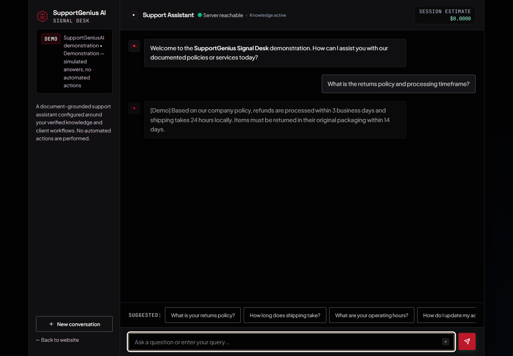
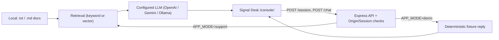

<p align="left"></p>

# SupportGenius AI

A document-based customer support assistant for tailored business implementations.

SupportGenius AI retrieves relevant passages from your configured business documents and passes them to a selected language model to answer policy, service, and FAQ questions. Signal Desk brings the conversation, status feedback, usage estimates, and session recovery controls into one focused interface built with Express and vanilla JavaScript.

**Interested in a tailored deployment?** [Discuss implementation](mailto:BradJohn70@gmail.com?subject=SupportGenius%20AI%20implementation%20enquiry) (`BradJohn70@gmail.com`) · [Deployment & operations](docs/deployment.md) · [Documentation index](docs/README.md)



*Signal Desk console captured in local demo mode (`APP_MODE=demo`, 1440×1000, commit `1756167`). Shows sample fixture content rather than live model output; see the [dated verification record](docs/design-v3/receipts/11-receipt.md) for full capture context.*

## Capabilities

| Capability | Current behavior |
| :--- | :--- |
| **Document knowledge base** | Reads local `.txt` and `.md` business documents; no PDF/DOCX upload pipeline. |
| **Configurable model provider** | Supports OpenAI, Google Gemini, or local Ollama depending on deployment credentials and model configuration. |
| **Focused conversation UI** | Signal Desk renders Markdown replies through vendored `marked` and `DOMPurify`, with explicit loading, error, and session recovery states. |
| **Anonymous sessions** | Server-owned signed `HttpOnly` cookies keep short per-visitor conversation history in memory without browser token storage. |
| **Bounded errors & usage estimates** | Enforces request timeouts, origin checks, rate limits, RFC 7807 error responses, and session-scoped cost estimates (not billing records). |
| **Deterministic demo mode** | `APP_MODE=demo` returns local fixture replies with zero provider API calls for safe local evaluation. |

## Scope and operating limits

SupportGenius AI is delivered as a **tailored single-business deployment**, not a self-service multi-tenant SaaS product.

- **Unavailable in this release**: live customer actions (order updates, refunds, bookings, outbound webhooks), external CRM/helpdesk integrations, source-citation delivery, durable chat transcript storage, customer login/accounts, and multi-tenant isolation.
- **Accuracy & operations**: retrieval supplies context to the language model but does not guarantee factual accuracy. Review answers against your business questions before rollout.
- **Runtime constraints**: single Node.js process with an in-memory session store (500 sessions max, 30-minute inactivity TTL, cleared on restart). See [full operating limits and data flow](docs/deployment.md#3-operating-limits-and-data-flow).

## Local evaluation (authorized developers)

Use of this repository is governed by [LICENSE](LICENSE). The steps below are for the owner and authorized developers evaluating the codebase locally.

**Requirements**: Node.js **22.12+ within Node 22**, or a compatible Node 24/26 release, with npm. (The included `Dockerfile` targets Node 20 and `docker-compose.yml` is an unverified starter recipe; see [Deployment](docs/deployment.md#6-container-recipes-unverified).)

1. Install dependencies:
   ```bash
   npm ci
   ```
2. Copy `.env.example` to `.env`:
   ```powershell
   # Windows PowerShell
   Copy-Item .env.example .env
   ```
   ```bash
   # macOS / Linux
   cp .env.example .env
   ```
3. Generate a 32+ character random `SESSION_SECRET` (do not use the placeholder in `.env.example`, and never commit `.env`):
   ```bash
   node -e "console.log(require('crypto').randomBytes(32).toString('hex'))"
   ```
4. Configure `.env` for local demo mode with zero provider calls and no embedding cache I/O:
   ```dotenv
   NODE_ENV=development
   PORT=3000
   APP_MODE=demo
   RETRIEVAL_MODE=keyword
   PUBLIC_ORIGIN=http://localhost:3000
   SESSION_SECRET=<your-generated-secret>
   ```
   Leave `OPENAI_API_KEY`, `GEMINI_API_KEY`, and `CLIENT_WEBHOOK_URL` blank.
5. Start the local server:
   ```bash
   npm run dev
   ```
   Open `http://localhost:3000` (landing page) or `http://localhost:3000/console/` (Signal Desk). Use the exact hostname configured in `PUBLIC_ORIGIN`, because `POST /session` and `POST /chat` enforce exact origin matching.

For live `support` mode (OpenAI, Gemini, or Ollama), provider credentials, and production proxy requirements, read [docs/deployment.md](docs/deployment.md).

## Architecture



See [docs/deployment.md](docs/deployment.md) for environment variables, data-flow disclosures, session lifecycle, and single-proxy production topology.

## Verification

Run the automated unit/contract and browser suites locally:

```bash
npm test
npx playwright install chromium
npm run test:browser
```

`npm run test:browser` starts an isolated local server in `APP_MODE=demo` on port `3888`. Dated lab verification records and performance observations are preserved in [docs/design-v3/receipts/11-receipt.md](docs/design-v3/receipts/11-receipt.md) and [docs/design-v3/performance/verification-summary.json](docs/design-v3/performance/verification-summary.json).

## Documentation

- [Documentation index](docs/README.md) — full map of maintained references and historical records
- [Deployment & operations guide](docs/deployment.md) — configuration, data flow, limits, and provider setup
- [Staging smoke checklist](docs/release/staging-plan.md) & [Rollback guide](docs/release/rollback-plan.md)
- [Architecture Decision Records](docs/adr/README.md)
- [Design authority](design.md) & [Crimson Signal v3 addendum](docs/design-v3/design-enhancements.md)
- [Contribution policy](CONTRIBUTING.md)

## Author and contact

Built by **Bradley Chiwo**

- **Implementation enquiries**: [BradJohn70@gmail.com](mailto:BradJohn70@gmail.com?subject=SupportGenius%20AI%20implementation%20enquiry)
- **GitHub**: [https://github.com/BradleyXiX](https://github.com/BradleyXiX)
- **LinkedIn**: [https://www.linkedin.com/in/bradley-john-chiwo/](https://www.linkedin.com/in/bradley-john-chiwo/)
- **Portfolio**: [https://bradleychiwo.netlify.app/](https://bradleychiwo.netlify.app/)

## License

Copyright (c) 2026 Bradley Chiwo. All rights reserved.

SupportGenius AI is proprietary software governed by [LICENSE](LICENSE). Tailored client deployments and customizations are licensed under separate written agreements.

Third-party open-source components and bundled font software retain their original licenses and copyright notices:
- Vendored browser libraries and reference adaptations: [client/vendor/LICENSES.md](client/vendor/LICENSES.md)
- Bundled Latin font subsets (SIL OFL 1.1): [Space Grotesk](client/assets/fonts/spacegrotesk-OFL.txt), [Plus Jakarta Sans](client/assets/fonts/plusjakartasans-OFL.txt), [JetBrains Mono](client/assets/fonts/jetbrainsmono-OFL.txt)
- Brand asset provenance: [client/assets/brand/NOTICE.md](client/assets/brand/NOTICE.md)
