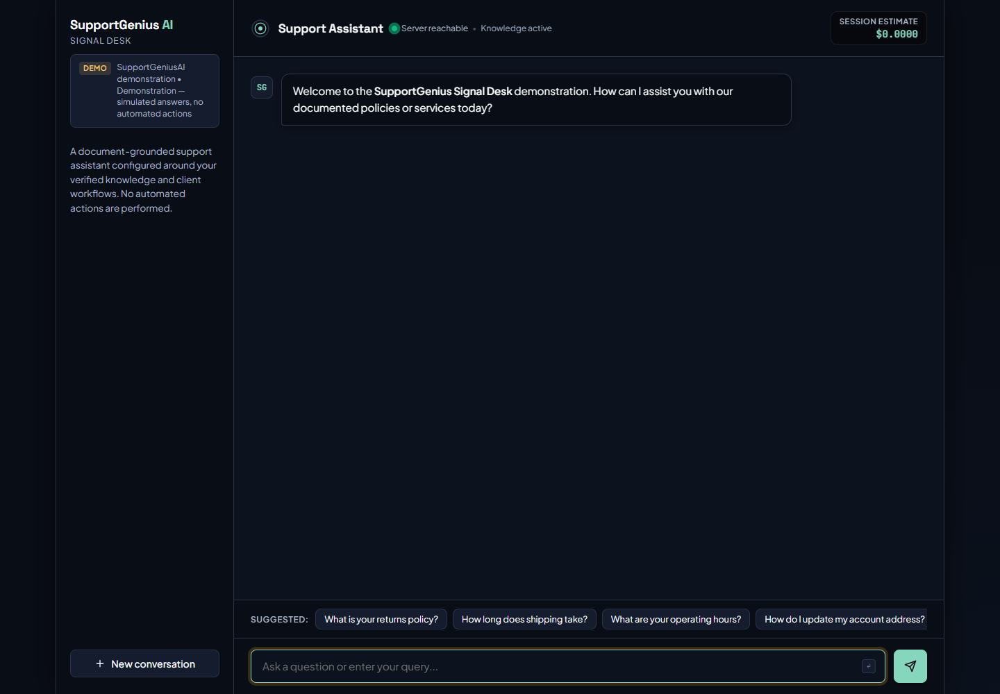
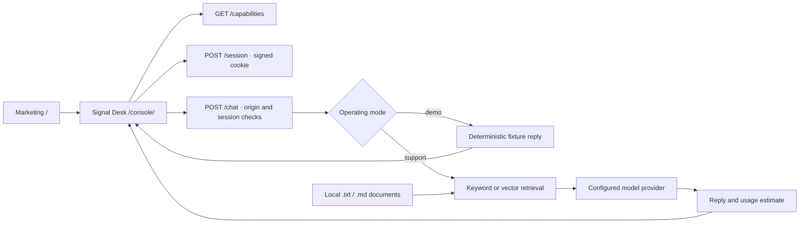
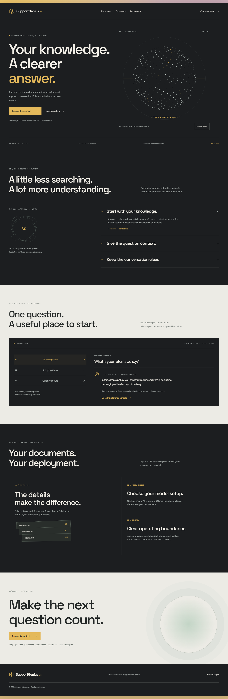

<p align="left"></p>

# SupportGenius AI

**Knowledge, made clear.** A document-based customer support assistant built with Express and vanilla JavaScript for tailored client deployments.

SupportGenius AI retrieves context from configured business documents and generates replies through a selected model provider. Signal Desk keeps the conversation, usage estimates, and recovery controls in one focused interface.

[Quick start](#quick-start) · [Architecture](#architecture) · [Verification](#verification) · [Deployment](docs/deployment.md) · [Design system](design.md)



*Current console, captured from the inspected application at `35f0793` in local demo mode. Screenshots contain sample content. They do not establish real-provider answer quality.*

## Current capabilities

| Available | Boundary |
| --- | --- |
| Text/Markdown document retrieval | Local `.txt` and `.md` documents; no PDF/DOCX upload pipeline |
| Configurable OpenAI, Gemini, or Ollama | Availability depends on provider credentials, model and deployment |
| Deterministic demo mode | Fixture replies, with no provider calls |
| Anonymous signed-cookie sessions | Not customer authentication; in-memory state expires and resets on restart |
| Bounded requests and recoverable errors | No guarantee of answer accuracy or provider availability |
| Usage/cost estimates | Estimates may be unavailable; not billing records |

Customer actions, live integrations, source-citation delivery, durable transcripts, and multi-tenant accounts are outside the current release. Retrieval provides context; review answer quality against known questions before client rollout.

## Quick start

Use Node.js **22.12+ within Node 22**, or a compatible Node 24 release, with npm. The test toolchain needs these runtimes. The current Dockerfile targets Node 20; align it before relying on Docker for development/tests.

```bash
git clone https://github.com/BradleyXiX/SupportGeniusAI.git
cd SupportGeniusAI
npm ci
```

If you already have a checkout, preserve any uncommitted work. The new visual design is prepared on `design/signal-architecture-v2`; it is local until explicitly published. A fresh default-branch clone may not contain the design kit.

Copy `.env.example` to `.env`:

```powershell
# Windows PowerShell
Copy-Item .env.example .env
```

```bash
# macOS / Linux
cp .env.example .env
```

Generate a local session secret:

```bash
node -e "console.log(require('crypto').randomBytes(32).toString('hex'))"
```

Set these values in `.env`, using your generated secret:

```dotenv
NODE_ENV=development
PORT=3000
APP_MODE=demo
PUBLIC_ORIGIN=http://localhost:3000
SESSION_SECRET=<generated-secret-at-least-32-characters>
```

Leave model keys and `CLIENT_WEBHOOK_URL` blank for the demo. Never commit `.env` or a real secret.

```bash
npm run dev
```

Open [the website](http://localhost:3000) or [Signal Desk](http://localhost:3000/console/). Use the same hostname as `PUBLIC_ORIGIN`: state-changing requests enforce that origin. Demo replies are fixtures.

For real inference, read [provider configuration and operations](docs/deployment.md). For Gemini-only deployments, `LLM_PROVIDER=gemini`, `RETRIEVAL_MODE=keyword` and an explicit `GEMINI_MODEL` allow document retrieval without an embedding provider. Model access, quota and answer quality must be checked in your own staging environment.

## Architecture



```text
client/                 Marketing site and Signal Desk console
server/app.js           Express app and middleware
server/routes/          Chat, session, capabilities and health
server/session/         Anonymous session store and lifecycle
server/services/        Retrieval, providers and usage estimates
server/data/docs/       Local knowledge documents
server/tests/           Unit and API contract tests
tests/browser/          Playwright journeys
docs/                   Architecture, operations and design handoffs
```

The current store uses process memory and local files. There is no external vector database or multi-tenant storage layer.

## Verification

```bash
npm test
npx playwright install chromium
npm run test:browser
```

The browser config starts an isolated demo server on port `3888`. Tests cover session ownership, origin enforcement, concurrency, provider bounds and console recovery. Automated accessibility checks complement manual keyboard, mobile and reduced-motion review.

The pre-redesign baseline on 20 November 2026 passed **151 unit/contract tests in 16 files**. This is a dated local result, not a live CI badge. See [design verification](docs/design-v2/verification.md) for this branch's reference checks and evidence gaps.

## Visual design work

The proposed **Signal Architecture** identity introduces an original signal-prism mark, a graphite/gold system, a point-sculpture hero, and an interactive product story. It is prepared on a separate local branch so production integration can proceed section by section.



*Design reference, not the currently integrated production landing page. Its sample conversations are scripted. The optional particle centerpiece uses native WebGL; the static SVG appears first.*

- [Design specification](design.md)
- [Antigravity implementation sequence](docs/design-v2/execution-plan.md)
- [Research and source audit](docs/design-v2/research.md)
- [Start the local reference](docs/design-v2/START-HERE.md)

## Deployment and operating limits

Read the [deployment guide](docs/deployment.md), [staging plan](docs/release/staging-plan.md) and [rollback plan](docs/release/rollback-plan.md) before releasing.

- Run one application process. Sessions are in memory, capped at 500, and expire after 30 minutes of inactivity. Restarts discard them.
- History is bounded to six exchanges. Cost/token displays are estimates.
- Production requires HTTPS, an explicit `PUBLIC_ORIGIN`, and a random `SESSION_SECRET` of at least 32 characters.
- Production sessions use the `__Host-supportgenius_session` cookie with Secure, HttpOnly and SameSite=Strict attributes.
- `trust proxy: 1` assumes one trusted proxy, restricted backend ingress and sanitized forwarding headers.
- `GET /health` checks liveness; HTTP 200 does not prove model connectivity or answer quality.
- Inspect live hosting branch tracking and preview policies before publishing any branch. A local branch does not prove remote deploy isolation.

## Contributing and documentation

Follow [CONTRIBUTING.md](CONTRIBUTING.md) and [AGENTS.md](AGENTS.md). Keep changes scoped, preserve API contracts and add meaningful regression coverage when behavior changes.

[Architecture decisions](docs/adr/README.md) · [Safe Support Foundation](docs/adr/0002-safe-support-foundation-and-anonymous-sessions.md) · [Deployment](docs/deployment.md) · [Release preparation](docs/release/safe-foundation-pr.md)

## License

The repository does not currently include a project license. The owner must choose one before representing it as open-source software under specific terms. Bundled fonts and vendor assets retain their own notices; see [design asset notices](docs/design-v2/assets/NOTICE.md) and [client vendor notices](client/vendor/LICENSES.md).
