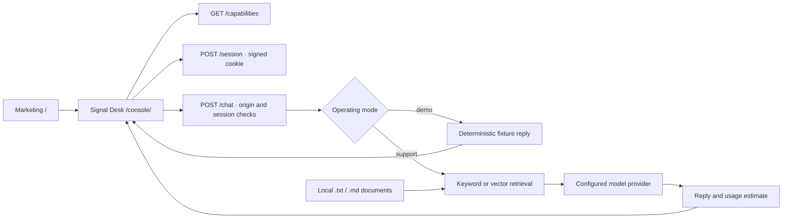
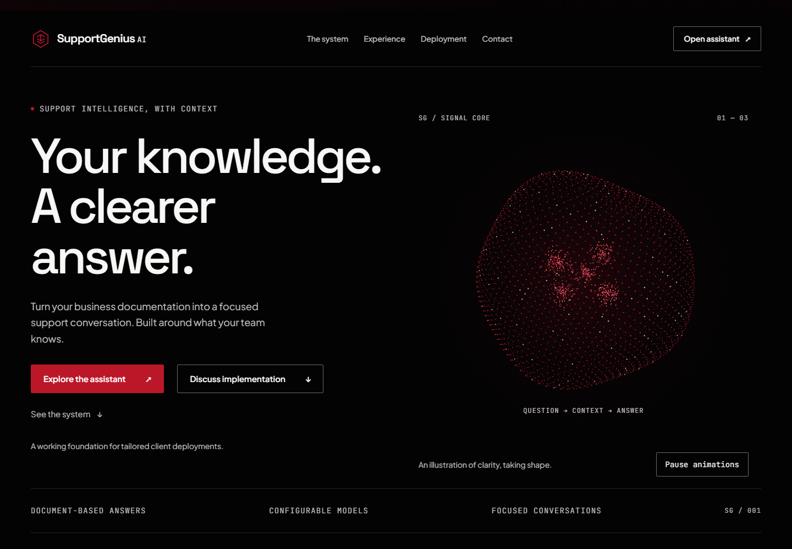
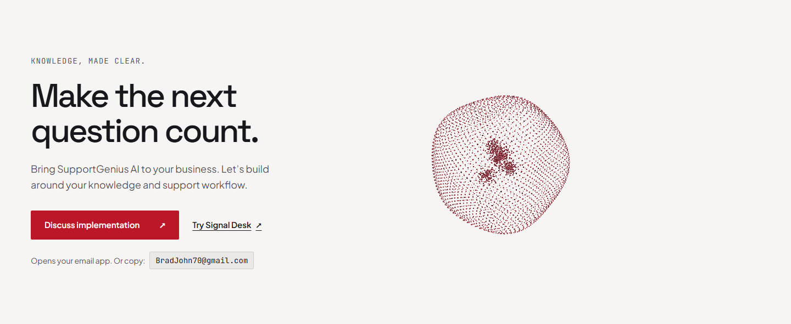

<p align="left"></p>

# SupportGenius AI

**Knowledge, made clear.** A document-based customer support assistant built with Express and vanilla JavaScript for tailored client deployments.

SupportGenius AI retrieves context from configured business documents and generates replies through a selected model provider. Signal Desk keeps the conversation, usage estimates, and recovery controls in one focused interface, while the Crimson Signal presentation showcases product capabilities, system architecture, and client implementation enquiries.

[Quick start](#quick-start) · [Architecture](#architecture) · [Verification](#verification) · [Deployment](docs/deployment.md) · [Design system](design.md) · [Implementation enquiries](#client-implementation-enquiries)


*Integrated Signal Desk workspace, captured from the live application at commit `1756167` in local demo mode (`APP_MODE=demo`, viewport 1440×1000). Demonstrates clean answered state with static crimson avatar mark, session cost estimate, and recovery controls. Contains sample fixture content; does not establish real-provider answer quality.*

## Current capabilities

| Available | Boundary |
| --- | --- |
| Text/Markdown document retrieval | Local `.txt` and `.md` documents; no PDF/DOCX upload pipeline |
| Configurable OpenAI, Gemini, or Ollama | Availability depends on provider credentials, model, and deployment |
| Deterministic demo mode | Fixture replies, with zero provider calls |
| Anonymous signed-cookie sessions | Not customer authentication; in-memory state expires and resets on restart |
| Bounded requests and recoverable errors | No guarantee of answer accuracy or provider availability |
| Usage/cost estimates | Estimates may be unavailable; not binding billing records |
| Truthful console lifecycle | Status driven by real client state (`idle`, `pending`, `settling`, `error`, `recovery`); no fake typing |
| Accessible motion controls | Default-on motion after first paint for eligible visible scenes; persistent pause preference (`sg_motion_v1`); OS reduced-motion override |
| Implementation enquiries | Direct email touchpoint (`#implementation-contact`); opens visitor email client without server form storage |

Customer actions, live integrations, source-citation delivery, durable transcripts, and multi-tenant accounts are outside the current release. Retrieval provides context; review answer quality against known questions before client rollout.

## Quick start

Use Node.js **22.12+ within Node 22**, or a compatible Node 24/26 release, with npm. The test toolchain requires these runtimes. The current Dockerfile targets Node 20; align it before relying on Docker for development/tests.

```bash
git clone https://github.com/BradleyXiX/SupportGeniusAI.git
cd SupportGeniusAI
npm ci
```

If you already have a checkout, preserve any uncommitted work. The Crimson Signal design enhancements are integrated on branch `design/crimson-signal-v3`.

Copy `.env.example` to `.env`:

```powershell
# Windows PowerShell
Copy-Item .env.example .env
```

```bash
# macOS / Linux
cp .env.example .env
```

Generate a local session secret:

```bash
node -e "console.log(require('crypto').randomBytes(32).toString('hex'))"
```

Set these values in `.env`, using your generated secret:

```dotenv
NODE_ENV=development
PORT=3000
APP_MODE=demo
PUBLIC_ORIGIN=http://localhost:3000
SESSION_SECRET=<generated-secret-at-least-32-characters>
```

Leave model keys and `CLIENT_WEBHOOK_URL` blank for the demo. Never commit `.env` or a real secret.

```bash
npm run dev
```

Open [the website](http://localhost:3000) or [Signal Desk](http://localhost:3000/console/). Use the same hostname as `PUBLIC_ORIGIN`: state-changing requests enforce that origin. Demo replies are fixtures.

For real inference, read [provider configuration and operations](docs/deployment.md). For Gemini-only deployments, `LLM_PROVIDER=gemini`, `RETRIEVAL_MODE=keyword` and an explicit `GEMINI_MODEL` allow document retrieval without an embedding provider. Model access, quota, and answer quality must be checked in your own staging environment.

## Architecture



```text
client/                 Marketing site and Signal Desk console (pure ES modules)
server/app.js           Express app, security headers, and middleware
server/routes/          Chat, session, capabilities, and health endpoints
server/session/         Anonymous in-memory session store and lifecycle
server/services/        Retrieval, providers, and usage estimates
server/data/docs/       Local knowledge documents (.txt, .md)
server/tests/           Unit and API contract tests (Vitest)
tests/browser/          End-to-end browser journey suites (Playwright)
docs/                   Architecture records, operations, and design specifications
```

The current store uses process memory and local files. There is no external vector database or multi-tenant storage layer.

## Verification

Run the full automated test suite locally:

```bash
npm test
npx playwright install chromium
npm run test:browser
```

The browser configuration launches an isolated local server on port `3888` in demo mode. Tests verify session ownership, origin enforcement, single-flight request gating, CSP compliance, error recovery, motion policy synchronization, and axe-core accessibility.

### Verified Suite Results

On branch `design/crimson-signal-v3`:
- **Vitest unit & API contract suite**: Passed **151 tests in 16 files** (exit 0).
- **Playwright browser integration suite**: Passed **134 tests across 10 suites** (exit 0):
  - `closing-footer.spec.js` (13/13 — includes desktop capture and unified closing layout verification)
  - `console.spec.js` (50/50 — includes 320px responsive overflow regression in empty and answered states)
  - `deployment.spec.js` (7/7)
  - `experience.spec.js` (9/9)
  - `marketing.spec.js` (8/8 — includes native anchor URL fragment and history preservation)
  - `network-texture.spec.js` (7/7 — sparse background decoration and motion policy coordination)
  - `orb.spec.js` (8/8)
  - `signal-core.spec.js` (16/16 — includes WebGL particle envelope, tilt interaction, and fallback tests)
  - `system-chapters.spec.js` (7/7)
  - `system-orbits.spec.js` (7/7 — rotating orbits and motion policy pause/resume synchronization)
- **Accessibility**: 0 serious or critical axe-core findings across both routes.

### Lab Performance & Asset Footprint

Measured on unthrottled loopback Chrome:
- **Landing page (`/`)**: Lab LCP 484 ms, Lab CLS 0.003
- **Signal Desk console (`/console/`)**: Lab LCP 160 ms, Lab CLS 0.0119

#### Exact Participating Asset Footprint

| Category | File | Disk Size (Raw) | Software Gzip Estimate |
| :--- | :--- | :--- | :--- |
| **Eager Landing JS** | `client/landing.js` | 15.14 KB (15,142 B) | 3.35 KB (3,351 B) |
| **Eager Landing JS** | `client/marketing/chapters.js` | 3.49 KB (3,494 B) | 1.16 KB (1,160 B) |
| **Eager Landing JS** | `client/marketing/examples.js` | 1.97 KB (1,968 B) | 0.81 KB (812 B) |
| **Eager Landing JS** | `client/marketing/motion-policy.js` | 5.21 KB (5,206 B) | 1.69 KB (1,692 B) |
| *Eager Landing JS Subtotal* | *4 modules* | **25.81 KB (25,810 B)** | **7.02 KB (7,015 B)** |
| **Deferred Landing JS** | `client/marketing/signal-core.js` | 18.44 KB (18,438 B) | 5.15 KB (5,153 B) |
| **Deferred Landing JS** | `client/marketing/network-texture.js` | 8.82 KB (8,817 B) | 2.73 KB (2,727 B) |
| *Deferred Landing JS Subtotal* | *2 modules* | **27.26 KB (27,255 B)** | **7.88 KB (7,880 B)** |
| **Console JS** | `client/app.js` | 29.86 KB (29,856 B) | 6.96 KB (6,955 B) |
| **Console JS** | `client/chat-state.js` | 2.31 KB (2,309 B) | 0.70 KB (703 B) |
| **Console JS** | `client/orb.js` | 10.80 KB (10,797 B) | 2.91 KB (2,906 B) |
| **Console JS** | `client/marketing/motion-policy.js` | 5.21 KB (5,206 B) | 1.69 KB (1,692 B) |
| *Console JS Subtotal* | *4 modules* | **48.17 KB (48,168 B)** | **12.26 KB (12,256 B)** |
| **Stylesheets** | `client/brand.css` | 17.86 KB (17,857 B) | 2.74 KB (2,743 B) |
| **Stylesheets** | `client/marketing.css` | 42.60 KB (42,600 B) | 6.44 KB (6,437 B) |
| **Stylesheets** | `client/styles.css` | 42.32 KB (42,322 B) | 7.17 KB (7,168 B) |
| *Stylesheets Subtotal* | *3 CSS files* | **102.78 KB (102,779 B)** | **16.35 KB (16,348 B)** |
| **Static Fonts** | `client/assets/fonts/display-1.woff2` | 22.29 KB (22,288 B) | WOFF2 compressed |
| **Static Fonts** | `client/assets/fonts/body-1.woff2` | 26.71 KB (27,348 B) | WOFF2 compressed |
| **Static Fonts** | `client/assets/fonts/mono-1.woff2` | 20.67 KB (21,168 B) | WOFF2 compressed |
| *Static Fonts Subtotal* | *3 WOFF2 subsets* | **69.14 KB (70,804 B)** | *Pre-compressed* |
| **Vector Artwork / Posters** | `client/assets/brand/signal-core-poster.svg` | 71.41 KB (71,408 B) | 10.66 KB (10,656 B) |
| **Vector Artwork / Posters** | `client/assets/brand/closing-sphere-poster.svg` | 10.16 KB (10,155 B) | 2.44 KB (2,442 B) |
| **Vector Artwork / Posters** | `client/assets/brand/network-texture-poster.svg` | 4.17 KB (4,167 B) | 0.96 KB (964 B) |
| **Vector Artwork / Posters** | `client/assets/brand/avatar-sphere.svg` | 1.31 KB (1,307 B) | 0.57 KB (570 B) |
| **Vector Artwork / Posters** | `client/assets/brand/supportgenius-mark.svg` | 0.37 KB (368 B) | 0.23 KB (227 B) |
| **Vector Artwork / Posters** | `client/assets/brand/favicon.svg` | 0.37 KB (368 B) | 0.23 KB (227 B) |

*Performance & transfer note*: All gzip values are software-calculated estimates using Deflate/Gzip compression, not measured HTTP wire transfers with live compression headers. Local lab observations do not establish real-world mobile cellular network performance, diverse hardware execution, or field INP. The system does not claim award readiness or public deployment status. See [design verification](docs/design-v2/verification.md) for detailed observations and evidence bounds.

## Visual design & integrated interface

The **Crimson Signal** design language establishes a refined signal-prism identity, deep crimson and garnet accents (`#931b32`, `#6b1424`), an ink-black foundational surface (`#0f0b0d`), warm paper interlude sections (`#fbf8f5`), and a kinetic WebGL point sculpture with static SVG poster fallback.



*Integrated marketing landing page, captured from the live application at commit `1756167` in local demo mode (`APP_MODE=demo`, viewport 1440×1000). Shows the animated crimson hero sculpture, capability bar, and architectural layout.*



*Unified closing section, captured from the live application at commit `1756167` in local demo mode (`APP_MODE=demo`, viewport 1440×1000). Shows the crimson wine sphere sculpture beside the "Make the next question count" call-to-action and implementation contact touchpoint.*

### Screenshot Provenance

| Interface | Image Path | Route | Commit | Viewport | Mode |
| :--- | :--- | :--- | :--- | :--- | :--- |
| **Signal Desk Answered** | [`docs/design-v3/screenshots/console-answered-1440.png`](docs/design-v3/screenshots/console-answered-1440.png) | `/console/` | `1756167` | 1440×1000 | `demo` |
| **Marketing Hero** | [`docs/design-v3/screenshots/landing-desktop-1440.png`](docs/design-v3/screenshots/landing-desktop-1440.png) | `/` | `1756167` | 1440×1000 | `demo` |
| **Closing Contact** | [`docs/design-v3/screenshots/closing-contact-desktop.png`](docs/design-v3/screenshots/closing-contact-desktop.png) | `/#implementation-contact` | `1756167` | 1440×1000 | `demo` |
| **Historical Concept Board (v2)** | [`docs/design-v2/screenshots/reference-desktop.png`](docs/design-v2/screenshots/reference-desktop.png) | *Prototype* | `3bcaf7f` | 1440×1000 | *Design Reference (Historical)* |

*Concept imagery disclosure*: The reference board above is historical design planning reference media from the v2 exploration phase. It is not production code and features standalone mock scripts.

Design documentation:
- [Design specification](design.md)
- [Design enhancements specification](docs/design-v3/design-enhancements.md)
- [Antigravity implementation sequence](docs/design-v2/execution-plan.md)
- [Research and source audit](docs/design-v2/research.md)
- [Design reference instructions](docs/design-v3/START-HERE.md)

## Client implementation enquiries

SupportGenius AI is designed for bespoke deployment across enterprise knowledge bases. Enquiries regarding custom installations, knowledge indexing, and architecture integration are handled directly:

- **Primary enquiry action**: [Discuss implementation](mailto:BradJohn70@gmail.com?subject=SupportGenius%20AI%20implementation%20enquiry)
- **Direct email address**: `BradJohn70@gmail.com`
- *Note*: Clicking the implementation enquiry link opens the visitor's local email application with a pre-formatted subject line. No server-side form submission, external CRM, or automated dispatch is invoked.

### Author & Engineering

Built by **Bradley Chiwo**:
- **Portfolio**: [https://bradleychiwo.netlify.app/](https://bradleychiwo.netlify.app/)
- **LinkedIn**: [https://www.linkedin.com/in/bradley-john-chiwo/](https://www.linkedin.com/in/bradley-john-chiwo/)
- **GitHub**: [https://github.com/BradleyXiX](https://github.com/BradleyXiX)

## Deployment and operating limits

Read the [deployment guide](docs/deployment.md), [staging plan](docs/release/staging-plan.md), and [rollback plan](docs/release/rollback-plan.md) before releasing.

- Run one application process. Sessions are in memory, capped at 500, and expire after 30 minutes of inactivity. Restarts discard them.
- History is bounded to six exchanges. Cost/token displays are estimates.
- Production requires HTTPS, an explicit `PUBLIC_ORIGIN`, and a random `SESSION_SECRET` of at least 32 characters.
- Production sessions use the `__Host-supportgenius_session` cookie with Secure, HttpOnly, and SameSite=Strict attributes.
- `trust proxy: 1` assumes one trusted proxy, restricted backend ingress, and sanitized forwarding headers.
- `GET /health` checks liveness; HTTP 200 does not prove model connectivity or answer quality.
- Inspect live hosting branch tracking and preview policies before publishing any branch. A local branch does not prove remote deploy isolation.

## Contributing and documentation

Follow [CONTRIBUTING.md](CONTRIBUTING.md) and [AGENTS.md](AGENTS.md). Keep changes scoped, preserve API contracts, and add meaningful regression coverage when behavior changes.

[Architecture decisions](docs/adr/README.md) · [Safe Support Foundation](docs/adr/0002-safe-support-foundation-and-anonymous-sessions.md) · [Deployment](docs/deployment.md) · [Release preparation](docs/release/safe-foundation-pr.md)

## License

The repository does not currently include a project license. The owner must choose one before representing it as open-source software under specific terms. Bundled fonts and vendor assets retain their own notices; see [v3 asset notices](docs/design-v3/assets/NOTICE.md), [v2 design asset notices](docs/design-v2/assets/NOTICE.md), and [client vendor notices](client/vendor/LICENSES.md).
