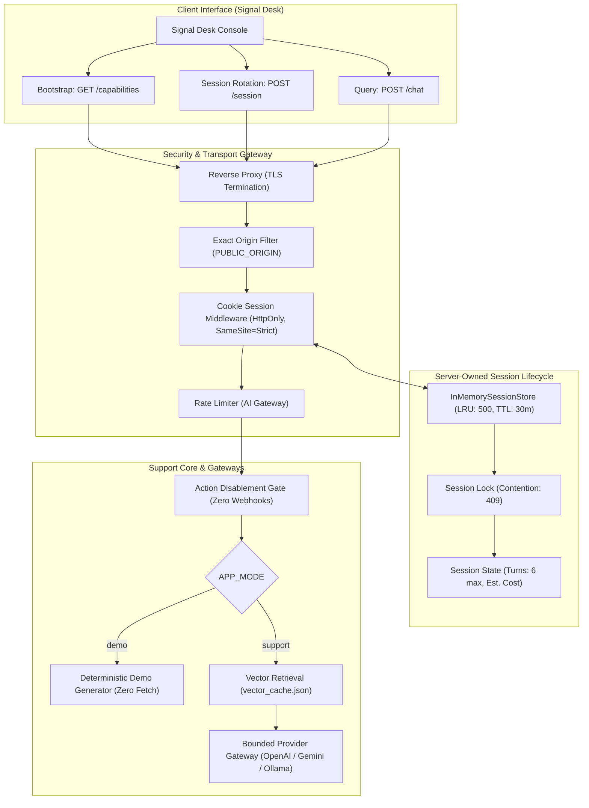

# ADR 0002: Safe Support Foundation — Anonymous Cookie Sessions, Action Guardrails, and Dual Operational Modes

- **Status**: Accepted
- **Deciders**: Platform Architecture, Design Systems, Security Engineering
- **Date**: 2026-11-07
- **Technical Context**: Transitioning SupportGeniusAI from prototype to a hardened, defensive support foundation requiring fail-closed action gating, server-owned anonymous session state, dual demo/support runtime isolation, and strict transport security without leaking secrets or introducing premature enterprise complexity.

---

## 1. Context & Problem Statement

SupportGeniusAI previously treated multi-turn conversation state with client-supplied session identifiers or in-memory arrays without security boundaries. Furthermore, tool execution paths contained theoretical webhook dispatches that could inadvertently execute real mutations against unvalidated third-party services.

To establish a production-viable, safe support platform:
1. **Action Risks**: Live tool mutations (order updates, booking, refunds) must not execute against external APIs or webhooks without explicit enterprise authentication, authorization, and customer consent protocols.
2. **Session Security**: Session identifiers must not reside in client JavaScript (`localStorage`, `sessionStorage`, or response JSON) where they are vulnerable to XSS extraction or client spoofing.
3. **Operational Clarity**: The application must operate in clearly differentiated modes (`support` for bounded production LLM inference; `demo` for zero-cost, zero-network reproducible demonstration).
4. **Transport & Origin Defense**: State-mutating endpoints (`/chat`, `/session`) must strictly verify the request `Origin` against `PUBLIC_ORIGIN` and run behind a trusted TLS-terminating reverse proxy.
5. **State Durability Limits**: A single-process in-memory session store provides safe, bounded conversation history for initial rollouts, but must be explicitly documented as ephemeral to avoid accidental multi-instance session desynchronization.

---

## 2. Decision Drivers

- **Defensive Safety First**: Unconditional action refusal. No customer order, address, or booking mutation can execute in this phase.
- **Zero Client Identity Storage**: Sessions are server-owned, identified strictly via `HttpOnly`, `SameSite=Strict`, `Secure` cookies.
- **Fail-Closed Gateways**: Strict Origin verification, 15s session operation deadlines, 45s chat response deadlines, and bounded 20s upstream timeouts.
- **Sanitized Logging**: Zero leakage of user query text, upstream URLs, cookies, or secrets in application logs.
- **Deterministic Verification**: Replace brittle timing assertions (`elapsed < 50ms`) with deterministic chunk cache-reuse assertions.

---

## 3. Architecture Overview

---

## 4. Key Architectural Decisions

### 4.1 Unconditional Action Disablement (Zero Live Webhooks)
- All agent action tools (`checkOrderStatus`, `updateAddress`, `bookAppointment`) fail closed immediately.
- Even if `CLIENT_WEBHOOK_URL` is configured in the environment, outbound requests are completely blocked.
- Tools return a deterministic, honest refusal informing the customer that live modifications are disabled in this environment.

### 4.2 Server-Owned Anonymous Cookie Sessions
- Anonymous sessions use cryptographically signed cookies (`s:sessionId.signature`) generated with `SESSION_SECRET` (minimum 32 characters).
- Cookie attributes: `HttpOnly: true`, `SameSite: Strict`, `Path: /`, and `Secure: true` in production environments (`NODE_ENV === "production"`).
- Zero session identifiers are stored in browser `localStorage`, `sessionStorage`, or returned in JSON responses.
- Active request locking guarantees concurrency isolation; overlapping queries on the same session return RFC 7807 `409 Conflict (SESSION_BUSY)`.

### 4.3 Explicit Dual Operational Modes (`support` vs `demo`)
- Controlled strictly via `APP_MODE` environment variable:
  - `support`: Executes real vector retrieval against `vector_cache.json` and invokes bounded LLM providers with non-empty text validation and strict 20s timeouts.
  - `demo`: Produces deterministic, grounded answers with zero upstream fetch calls, zero embedding calls, and zero inference costs.
- Both modes enforce identical action disablement, session rotation rules, and CSP policies.

### 4.4 Single-Process Deployment Constraint & Store Sizing
- The current implementation employs an in-memory session store (`InMemorySessionStore`) with:
  - Maximum capacity: 500 active sessions (LRU eviction).
  - Inactivity expiration: 30 minutes TTL.
  - History retention: Sliding window of 6 turns (12 messages).
- **Hard Architectural Limit**: Deployments are restricted to **exactly one process**. Horizontal autoscaling or multi-replica clusters will cause session thrashing and 401 errors. Multi-instance deployments strictly require replacing the in-memory store with an external shared store (e.g., Redis).
- Server restarts clear all active sessions cleanly; clients detect missing sessions via `401 Unauthorized (SESSION_REQUIRED)` and execute explicit recovery bootstrap.

### 4.5 Exact Origin Validation & Reverse Proxy Trust Topology
- State-mutating endpoints (`POST /chat`, `POST /session`) enforce that `req.headers.origin` strictly matches `PUBLIC_ORIGIN`.
- Missing or mismatched origins are rejected with `403 Forbidden (INVALID_ORIGIN)`.
- Behind reverse proxies (e.g., Render, Cloudflare, Nginx), `app.set("trust proxy", 1)` enables accurate `req.secure` inspection for HTTPS enforcement.
- When `NODE_ENV === "production"`, `PUBLIC_ORIGIN` must use the `https://` protocol scheme.

---

## 5. Trade-offs Matrix

| Architectural Choice | Advantages | Trade-offs / Limitations | Mitigation |
| :--- | :--- | :--- | :--- |
| **Unconditional Action Disablement** | Eliminates side-effects, unauthorized mutations, and webhook vulnerabilities. | Customer cannot perform live order changes or bookings in UI. | Honest, clear refusal messaging; customer guided to official support channels. |
| **Anonymous Signed Cookies** | Complete protection against XSS token theft; zero client storage needed. | Requires browser cookie support; mobile webviews must support cookies. | Standard cookie protocol; verified with automated Playwright browser suites. |
| **In-Memory Session Store** | Zero external database dependencies; fast and lightweight; zero operational cost. | Ephemeral; state lost on restart; limits deployment to single process. | Explicitly documented; LRU bounds prevent memory leaks; 500-session cap. |
| **Exact Origin Check** | Blocks cross-site request forgery (CSRF) and rogue cross-origin callers. | Prevents multi-domain console embedding without proxying. | Single canonical `PUBLIC_ORIGIN` configuration per deployment. |

---

## 6. Deferred Architectural Decisions

The following capabilities are deliberately excluded from this foundation phase and deferred to subsequent project milestones:
1. **Customer Identity & Authentication**: User login, OAuth/OIDC integration, and customer account profiles.
2. **Multi-Tenant SaaS Partitioning**: Organization-level isolation, customer RBAC, and tenant configuration.
3. **Durable Database Persistence**: PostgreSQL/SQLite storage for chat histories, audit logs, and transcript retention.
4. **Distributed Session Storage**: Redis or Valkey session adapters for multi-instance horizontal scaling.
5. **Live Action Integrations**: Authenticated CRM, Shopify, or calendar webhook execution.
6. **Dynamic Knowledge Re-indexing**: Live document uploads and real-time embedding generation pipelines.

---

## 7. References

- [ADR 0001: Enterprise Hardening](0001-ecc-production-hardening-architecture.md)
- [Safe Support Foundation Specification](../superpowers/specs/2026-11-07-safe-support-foundation-design.md)
- [Safe Support Foundation Plan](../superpowers/plans/2026-11-07-safe-support-foundation.md)
- [RFC 7807: Problem Details for HTTP APIs](https://datatracker.ietf.org/doc/html/rfc7807)
