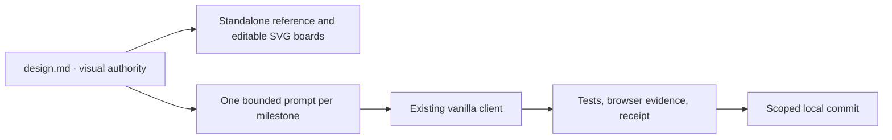

# ADR-0003: Signal Architecture design reference and staged integration

> [!NOTE]
> **Status update (2026-11-23):** Signal Architecture v2 (`design/signal-architecture-v2`, PR #6) and Crimson Signal v3 (`design/crimson-signal-v3`, PR #7) have since been merged into `main`. Root [design.md](../../design.md) remains the base design authority, with [docs/design-v3/design-enhancements.md](../design-v3/design-enhancements.md) as its active v3 override for palette, legibility, motion defaults, closing contact, and console styling.

Type: explanation. Status: integrated (extended by Crimson Signal v3). Date: 20 November 2026.

## Context

The user requested a branded, expressive redesign inspired by a particle-based website reference, a Figma reference, detailed prompts, small commits, and isolation from automatic deployments. The application is Express with vanilla ES modules. Existing contracts and console recovery behavior already have test coverage. Historical conversation recommendations propose a different stack and features the current application does not provide.

## Decision

Keep Express, the vanilla client, native scrolling, real routes and API contracts. Establish root design.md as the new branch's design authority and docs/design-v2 as shared execution context. Build a standalone marketing/console reference with SVG first paint and optional native WebGL point geometry. Do not integrate the reference fixture handler into the production console. Use section-sized Antigravity tasks, scoped commits and receipts. No push or deployment in this phase.

## Options

| Option | Fit | Cost / risk |
| --- | --- | --- |
| Next.js/React/Lenis rewrite | Matches some historical examples | Adds toolchain and migration without product need; conflicts with current constraints |
| Existing vanilla client plus a large 3D engine | Useful for complex imported scenes | Unnecessary dependency for a small point sculpture |
| Vanilla plus progressive optional native WebGL | Chosen; bounded scope and portable reference | Custom module needs lifecycle/fallback tests |
| Static-only redesign | Smallest runtime cost | Misses requested interactive 3D reference; retained as the default fallback |

## Consequences

The production surface can be integrated incrementally without backend changes. The new brand, copy and motion share one authority. Static content remains usable without enhancement. Optional 3D is confined to the marketing hero; this does not authorize heavy canvases, custom cursors, scroll hijacking, or framework migration. Code, screenshots, test counts and product claims remain explicitly separated between current application and proposed reference.

Figma file creation succeeded but Starter-plan MCP limits blocked native design construction. Editable SVG boards are the fallback; they do not claim auto-layout, token binding or a completed Figma component library.

## Verification

Current source baseline: 151 unit/contract tests passed. Reference: 32 targeted browser checks passed after documented corrections, separate code review approved the fixes. Full integrated browser suite, production-like trace, real devices, provider quality and remote deployment policy remain later gates. See docs/design-v2/verification.md.
